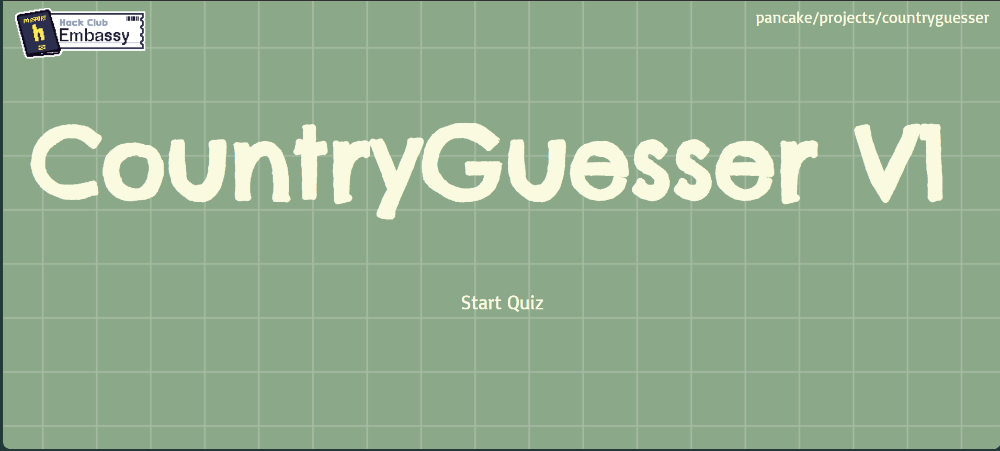
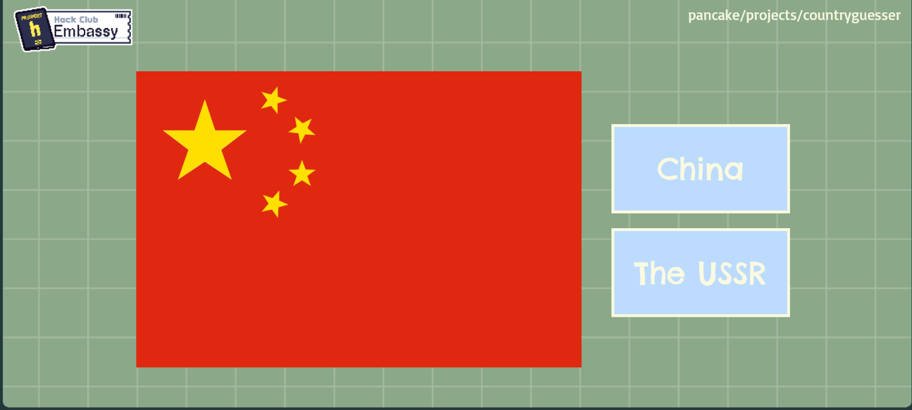
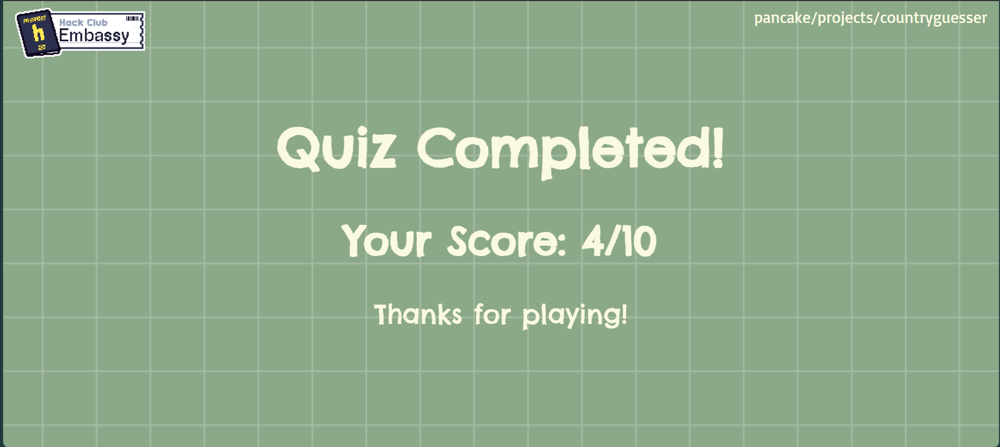

# Country-Guesser
Website where you gotta guess the country based on its flag

## Project Info
- This is a website that's made to test your geography knowledge!
- Beginner site, my first one with javascript :p
- Not the best but will do future changes

## Tech Stack
- Used HTML, CSS, and JavaScript.
- Uses a variety of functions to call out questions from a pre defined list

## Problems I faced
- Prob learning JS, took a while and a few tutorials but eh it works!

## How to run
- Demo this at https://countryguesser-beryl.vercel.app/

## Photos
- 
- 
- 

## Fun stuff
- The embassy logo is clickable, and so is the link on the top right.

## AI Disclosure
- Not a lot, used it to find mini errors, like I once spent 15 mins trying to figure out what was wrong with my code, and I realized that I put an l in the place of an I-

## Thanks for checking this out!

